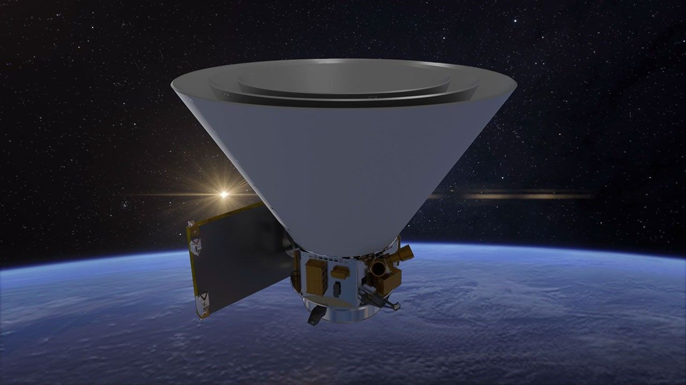
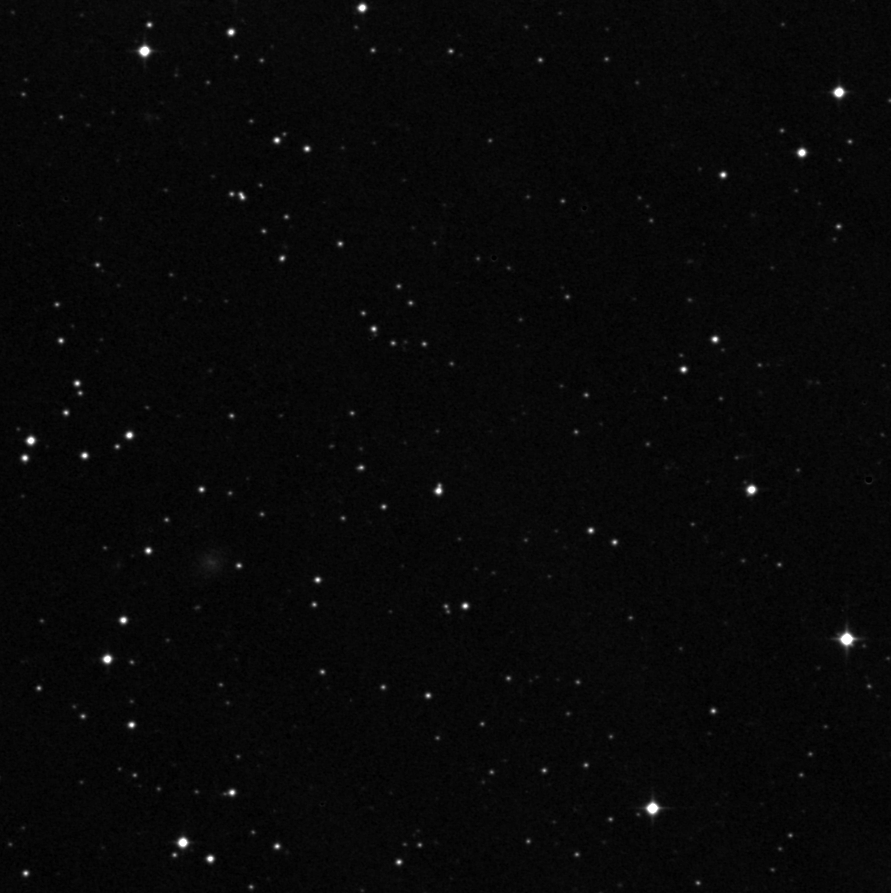
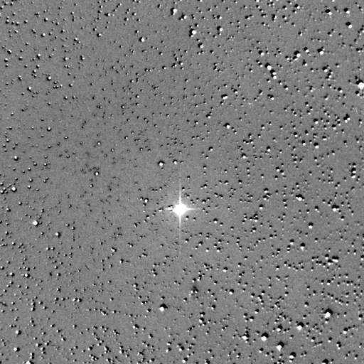

# ORBITAL — SPHEREx Practice Explorer

[](https://www.spaceappschallenge.org/)
[](LICENSE)
[-black?style=for-the-badge&logo=next.js)](https://nextjs.org/)
[](https://fastapi.tiangolo.com/)
[](https://www.astropy.org/)
[](https://sass-lang.com/)

<p align="center">
  
</p>

Decorative artwork: [SPHEREx in Orbit (Artist's Concept)](https://science.nasa.gov/photojournal/spherex-in-orbit-artists-concept/), credit NASA/JPL-Caltech.

**ORBITAL** is an independent practice prototype exploring the **NASA International Space Apps Challenge 2026** challenge *"Planet X and SPHEREx"*. It is not an official NASA or Space Apps project.

**AI assistance disclosure:** Language-model tools assisted with code development and project documentation. No AI-generated astronomical data, observation imagery, or scientific results are used; the illustrative spectral sonification is generated programmatically. This disclosure is also shown in the app's Sources & Calculations page.

The app queries NASA/IPAC IRSA for live SPHEREx archive records and provides curated Digitized Sky Survey (DSS) reference-image demonstrations for selected targets. Curated sequence dates are illustrative. Reference images, display-level comparisons, and generated spectral views are not SPHEREx measurements, calibrated photometry, or scientific detections.

---

## 1. Key Features & Workspaces

- **Sky Explorer**: Search the live archive, view curated DSS photographic reference cutouts, and browse the Aladin sky atlas.
- **Image comparison tools**: Blink and compare image previews. These operations are display-level only; they are not WCS registered, PSF matched, or calibrated measurements.
- **Planet X simulator**: Explore idealized parallax and circular-orbit estimates. This is an educational model, not a detection or orbit fit.
- **Illustrative spectral inspector**: Explore generated spectral curves and sonification; they are not retrieved or measured SPHEREx spectra.
- **Visual review marks**: Place a note on the image canvas and export its approximate canvas coordinates. This does not perform a catalog cross-match or confirm a source.
- **Astrometric calculators**: Calculate descriptive coordinate offsets and rates from field centers or entered coordinates, not calibrated stellar proper motion.
- **Multi-Wavelength Sky Atlas**: Browse optical, near-infrared, and mid-infrared HiPS surveys through CDS Aladin.
- **Image preview pipeline**: FastAPI and Astropy create display previews from available FITS data. Display stretching does not calibrate photometry.
- **Curated target suite**: Five challenge-named targets and four extra practice objects with DSS reference images; sequence dates are illustrative.
- **My Research**: Create browser-local studies, attach images and supporting files, compare image statistics, and export a text report.
- **Study Notes, site guide, and first-visit tour**: Keep notes in this browser and find help for the workspaces.
- **Sources & Calculations**: Review archive links, catalog references, equations, and limits at `/sources`.
- **Light and dark themes**: The site-wide toggle also applies to the Research and Sources pages.
- **Editorial Astrometric Interface**: Built with a clean, high-contrast scientific aesthetic (`#F7F7F5` warm paper canvas, `#111111` editorial typography, Inter, DM Serif Display, and JetBrains Mono) with full responsive support across mobile, tablet, and desktop viewports.

---

## 2. Practice Targets

The first five rows are named in the challenge materials; the remaining four are extra practice targets. The curated images are reference plates and are not SPHEREx observations.

| Target | Object type | Curated demo focus |
| :--- | :--- | :--- |
| **WISE 0855-0714** | Y-type brown dwarf | Curated DSS photographic reference frames |
| **Barnard's Star** | M-type red dwarf | Curated DSS photographic reference frames |
| **Epsilon Indi Ba/Bb** | Brown dwarf pair | Curated DSS photographic reference frames |
| **RW Aurigae** | Young stellar object | Curated DSS photographic reference frames |
| **R Draconis** | Mira-type variable star | Curated DSS photographic reference frames |
| **Kapteyn's Star** | Halo subdwarf | Curated DSS photographic reference frames |
| **Wolf 359** | Red dwarf | Curated DSS photographic reference frames |
| **Mira (Omicron Ceti)** | Pulsating red giant | Curated DSS photographic reference frames |
| **Teegarden's Star** | Red dwarf | Curated DSS photographic reference frames |

The target catalog describes object context. Curated images are optical reference plates with illustrative sequence dates; they do not measure the objects' motion, variability, or spectra.

### Reference Image Examples

| **WISE 0855-0714 reference image** | **Barnard's Star reference-image comparison** |
| :---: | :---: |
|  |  |
| *Curated DSS photographic reference image* | *Display-level comparison; not a proper-motion measurement* |

---

## 3. Mission Context & Data Sources

ORBITAL queries NASA/IPAC IRSA for live SPHEREx archive records and retrieves curated reference cutouts from STScI's Digitized Sky Survey. Other links are documentation, catalog references, or layers available inside the embedded Aladin viewer; their presence does not mean the app queries or combines their data with SPHEREx:

1. **NASA/IPAC Infrared Science Archive (IRSA)**
   - *URL*: [https://irsa.ipac.caltech.edu/Missions/spherex.html](https://irsa.ipac.caltech.edu/Missions/spherex.html)
   - *Role*: Queried by the backend for released SPHEREx records and FITS image products.
2. **Space Telescope Science Institute (STScI) Digitized Sky Survey (DSS)**
   - *Role*: Queried for curated optical photographic reference cutouts. Displayed demo sequence dates are illustrative and are not the plate observation dates.
3. **Two Micron All Sky Survey (2MASS)**
   - *Role*: Survey layer available in the embedded Aladin viewer; the app does not use 2MASS measurements in its calculations.
4. **Wide-field Infrared Survey Explorer (AllWISE / NEOWISE)**
   - *Role*: Survey layers available in the embedded Aladin viewer; the app does not use WISE measurements in its calculations.
5. **ESA Gaia DR3 (Data Release 3)**
   - *Role*: Catalog reference link only; the app does not query Gaia DR3 or use Gaia measurements for its calculations.
6. **Centre de Données astronomiques de Strasbourg (CDS)**
   - *Role*: Provides the Aladin viewer and its available HiPS sky layers.

---

## 4. Architecture & Technology Stack

```
Orbital/
├── backend/
│   ├── app/
│   │   ├── main.py                     # FastAPI application setup & CORS configuration
│   │   ├── config.py                   # Pydantic settings & cache management
│   │   ├── models/schemas.py           # Pydantic data schemas
│   │   ├── services/
│   │   │   ├── catalog.py              # Curated practice targets & reference-image records
│   │   │   ├── comparison_engine.py    # Spatial separation & flux delta engine
│   │   │   ├── fits_processor.py       # Display-only FITS decoding and custom asinh previews
│   │   │   ├── nasa_irsa.py            # NASA/IPAC IRSA SIA v2 query client
│   │   │   └── target_resolver.py      # Celestial name to RA/Dec coordinate resolver
│   │   └── routes/
│   │       ├── compare.py              # POST /api/compare
│   │       ├── guide.py                # POST /api/guide
│   │       ├── images.py               # GET /api/images/{id} & GET /api/diff
│   │       ├── observations.py         # GET /api/observations/{id}
│   │       ├── search.py               # POST /api/search
│   │       └── targets.py              # GET /api/targets
│   ├── cache/                          # Cached FITS inputs and display previews
│   └── requirements.txt                # Python backend dependencies
│
├── docs/
│   └── images/                         # Architectural diagrams, screenshots & previews
│
└── frontend/
    ├── src/
    │   ├── app/
    │   │   ├── layout.tsx              # Root layout with ORBITAL branding & fonts
    │   │   ├── page.tsx                # Editorial Landing Page & 4-Act Story
    │   │   ├── explore/page.tsx        # Interactive Sky Explorer & Observation Sheet
    │   │   ├── compare/page.tsx        # Comparative Astrometry & Differential Studio
    │   │   ├── about/page.tsx          # SPHEREx mission briefing and prototype limits
    │   │   └── observation/[id]/       # Observation record and provenance view
    │   ├── components/
    │   │   ├── AladinSkyAtlas.tsx      # Multi-wavelength high-res HiPS survey atlas
    │   │   ├── AstrometricCalculator.tsx # Coordinate offset calculator
    │   │   ├── ComparisonSlider.tsx    # Split-view draggable before/after comparator
    │   │   ├── Footer.tsx              # Minimalist footer with legal & NASA disclaimers
    │   │   ├── ImageViewer.tsx         # Pan, zoom, blink, reticle & citizen science dossier exporter
    │   │   ├── LightCurveAnalyzer.tsx  # Illustrative time-series curve
    │   │   ├── Navbar.tsx              # Sticky header with navigation & responsive drawer
    │   │   ├── ObservationTimeline.tsx # Multi-epoch cadence timeline & animation player
    │   │   ├── PlanetXCalculator.tsx   # Interactive parallax, Keplerian period & SPHEREx pixel shift
    │   │   └── SpectralInspector.tsx   # Illustrative spectral curves and audio sonification
    │   ├── lib/api.ts                  # Typed client for FastAPI backend
    │   ├── styles/main.scss             # Sass design system, typography & animations
    │   └── types/index.ts              # TypeScript interfaces
    ├── package.json                    # Next.js 16, React 19, Tailwind, GSAP, Lucide dependencies
    └── tailwind.config.ts              # Custom typography and color design tokens
```

---

## 5. Quickstart & Installation

### Prerequisites
- **Node.js**: v20.9 or newer (required by Next.js 16)
- **Python**: v3.10+ (Tested on Python 3.12)

---

### Deploy on Vercel

The repository includes a root `vercel.json` with separate `frontend` (Next.js) and
`backend` (FastAPI) services. Import this repository into Vercel with the repository
root as the project root. The public domain routes `/api/*` to FastAPI and all other
paths to Next.js. The frontend's `BACKEND_URL` is supplied automatically by its
service binding; do not add that variable manually. For local Vercel service routing,
run `vercel dev --local` from the repository root.

The backend stores disposable FITS and preview caches under `/tmp/orbital-cache` on
Vercel. Vercel function temporary storage can be cleared between instances, so cache
contents and search-result records are not durable across cold starts. Use a persistent
storage service if durable cross-instance search results are required.

---

### Step 1: Backend Setup (FastAPI & Astropy)

1. Open a terminal in the project directory and create a virtual environment:
   ```bash
   python -m venv backend/venv
   ```

2. Activate the virtual environment:
   - **Windows (PowerShell)**:
     ```powershell
     .\backend\venv\Scripts\Activate.ps1
     ```
   - **macOS / Linux**:
     ```bash
     source backend/venv/bin/activate
     ```

3. Install required Python packages:
   ```bash
   pip install -r backend/requirements.txt
   ```

4. Start the FastAPI server:
   ```bash
   uvicorn app.main:app --host 127.0.0.1 --port 8000 --app-dir backend --reload
   ```

   The backend will be live at:
   - **API Base**: `http://127.0.0.1:8000`
   - **Swagger Docs**: `http://127.0.0.1:8000/docs`
   - **Health Check**: `http://127.0.0.1:8000/api/health`

---

### Step 2: Frontend Setup (Next.js 16)

1. In a second terminal, navigate to the `frontend` folder:
   ```bash
   cd frontend
   ```

2. Install dependencies:
   ```bash
   npm install
   ```

3. Start the Next.js development server:
   ```bash
   npm run dev
   ```

4. Open your browser and navigate to:
   ```
   http://localhost:3000
   ```

---

## 6. API Endpoints Reference

| Method | Endpoint | Description |
| :--- | :--- | :--- |
| `GET` | `/` | API status, version, and mission overview |
| `GET` | `/api/health` | Backend service health check |
| `GET` | `/api/targets` | List curated targets and catalog coordinates |
| `POST` | `/api/search` | Query observations by object designation or RA/Dec coordinates |
| `GET` | `/api/observations/{id}` | Retrieve an observation record and its provenance metadata |
| `GET` | `/api/images/{id}` | Return a labeled display preview when available; previews are not calibrated photometry |
| `GET` | `/api/diff` | Return a display-level raster difference or co-addition; no astrometric registration is performed |
| `POST` | `/api/compare` | Return descriptive comparison fields; results are not a source-motion detection |
| `POST` | `/api/guide` | Get a response from the site guide |

---

## 7. Non-Endorsement & Legal Disclaimer

**ORBITAL** is an independent community open-source project developed exclusively for the **NASA International Space Apps Challenge 2026**. It is not an official NASA product and is neither created nor endorsed by the National Aeronautics and Space Administration (NASA), the Jet Propulsion Laboratory (JPL), or the California Institute of Technology (Caltech). All astronomical imagery and survey data are property of their respective scientific archives.

---

## 8. Code and image licenses

Original project code is distributed under the [MIT License](LICENSE). That license does not apply to third-party image assets.

The curated DSS reference images and the Barnard's Star display-difference image are covered by the [MAST DSS data-use policy](https://archive.stsci.edu/publishing/data-use), which identifies DSS uses as CC BY-NC-SA 4.0, limits them to non-commercial use, and says rights depend on the original plate. The app records each STScI query URL and the source FITS survey and plate identifiers in `backend/app/services/catalog.py`; acknowledge the originating survey and STScI. The MIT license does not cover those image assets. Contact STScI about licensing before any commercial use.

The SPHEREx hero artwork is a NASA/JPL-Caltech artist's concept, not observation data, and is credited separately above. Built for educational exploration and review workflows.
